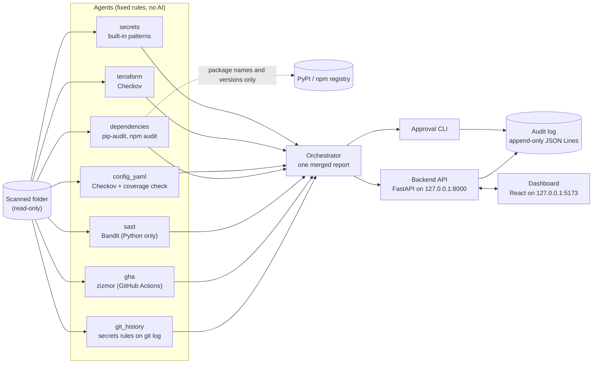

# Sentinel

[](https://github.com/samiiraqi/sentinel/actions/workflows/ci.yml)

Sentinel is a read-only security scanner for a code folder. Specialist agents look for hard-coded secrets (in the current files and in git history), insecure Terraform, insecure Kubernetes / Dockerfile / GitHub Actions config, known-vulnerable packages, and insecure Python code. A person reviews every finding, and every decision is written to an append-only audit log.

https://github.com/user-attachments/assets/b4bb6e6d-b91c-486f-be12-415355df60f8

## What it does

- **Finds problems.** Seven agents scan a folder and an orchestrator merges their results into one report.
- **Changes nothing.** Agents only read files. Nothing is fixed, installed, or deployed, and Terraform is never run.
- **Leaves the decision to a person.** Each finding is approved, rejected, or deferred by a human, from a CLI or a web dashboard. A decision is a record only; it never triggers an action.

In this project an **agent** is a specialist scanner with fixed rules: a Python module that runs its own checks or a well-known tool (Checkov, pip-audit, npm audit, Bandit, zizmor, git) and turns the result into findings. **No agent calls an AI model.**

## Architecture



- **Agents** (`agents/`) each scan the folder and return findings with the same fields: `agent`, `rule_id`, `severity`, `file`, `line`, `message`, `redacted_match`.
- **Orchestrator** (`orchestrator/`) runs every agent, applies a fixed severity table for a few known rules, sorts the findings, and prints one JSON report. If one agent fails, the others still run and the failure is shown in the report.
- **Approval** (`approval/`) is an interactive CLI to review findings and record decisions.
- **Backend** (`backend/`) is a FastAPI app that serves the report and records decisions. It listens on 127.0.0.1 only.
- **Dashboard** (`dashboard/`) is a React + TypeScript app that shows the report and lets you approve, reject, or defer findings.
- **Audit log** (`audit/decisions.jsonl`) holds one JSON line per decision. Lines are only ever appended.

## Agents

| Agent | Tool | What it checks | Network |
|---|---|---|---|
| `secrets` | Built-in patterns | AWS access key IDs, private key headers, Anthropic API keys, and generic `password` / `secret` / `token` / `api_key` assignments. Found values are redacted to at most 4 characters plus `****`. | No |
| `terraform` | Checkov (`--framework terraform`) | Insecure Terraform resources, such as SSH open to the world, public S3 buckets, or unencrypted volumes. `.tf` files Checkov cannot parse become `terraform-unscanned` findings. | No (`--skip-download`) |
| `config_yaml` | Checkov (Kubernetes, Dockerfile) | Insecure Kubernetes manifests and Dockerfiles. Its own coverage check reports invalid YAML and Dockerfiles Checkov skipped (for example binary or non-UTF-8 files) as `config-unscanned`. GitHub Actions files are left to the `gha` agent. | No (`--skip-download`) |
| `dependencies` | pip-audit, npm audit | Known-vulnerable packages in `requirements*.txt` (pinned `name==version` lines) and `package-lock.json`. Unpinned lines become `unpinned-dependency`; anything it cannot check becomes `unaudited-dependency`. | **Yes**: sends package names and versions only. `--offline` makes it refuse to run. |
| `sast` | Bandit | Insecure Python code (`.py`, `.pyw`), such as `shell=True`, `eval`, `pickle`, or `yaml.load`. Runs with its own empty Bandit config and `--ignore-nosec`, so a scanned folder's `.bandit` / `pyproject.toml` settings and `# nosec` comments cannot hide findings. Files Bandit cannot parse (syntax errors, non-UTF-8) or returns no result for, symlinks, and files over 5 MB become `sast-unscanned`. `assert` (B101) is not reported in test files; every other rule still applies there. Python only. | No |
| `gha` | zizmor (`--persona regular`) | Insecure GitHub Actions workflows (`.github/workflows/*.yml`) and `action.yml` files, such as template injection, overly broad permissions, unpinned actions, or checkout keeping credentials. It is the only agent that scans these files. Runs with `--no-config` and `--no-ignores`, so a scanned folder's `zizmor.yml` and `# zizmor: ignore` comments cannot hide findings. Files zizmor cannot parse (invalid YAML, not a valid workflow), non-UTF-8 files, symlinks, and files over 5 MB become `gha-unscanned`. | No (`--offline`; GitHub tokens are not passed to it) |
| `git_history` | git (`git log -p`) and the secrets agent's rules | Secrets that were committed once and are no longer in the current files, on every commit reachable from any branch, tag, or remote ref. A value still in the current files is left to the `secrets` agent, so it is not reported twice. Each finding's `file` is `path@<12-char commit>`. The scanned repo's git config and `.gitattributes` cannot run a program or hide history. A folder that is not a git repo, a repo with no commits, a shallow clone, or a partial clone gives `git-history-unscanned`. | No (only reads local history; partial clones are refused) |

Every agent has the same exit codes: `0` = no findings, `1` = findings, `2` = error.

## Design principles

- **Read-only.** Agents open files for reading only. pip-audit runs with `--disable-pip --no-deps` on a temporary copy of the pinned lines; npm audit runs with `--package-lock-only`; Checkov runs offline with no API key passed to it; Bandit parses Python files without running them; zizmor runs with `--offline` and never with `--fix`; the git_history agent runs only `git rev-parse`, `config --get-regexp`, `rev-list`, and `log`, and never changes history.
- **A scan never looks clean by accident.** A missing tool, a bad exit code, empty or invalid tool output, or a timeout is an error (exit `2`), not "no findings". Files a tool silently skipped are reported as `*-unscanned` findings. The orchestrator exits `2` if any agent failed, and the dashboard shows a "Scan incomplete" banner.
- **No raw secrets in output.** Findings carry only redacted values and the tool's check id, name, file, line, and resource id (for Bandit: test id, test name, CWE, and confidence); raw file content is never copied into a finding. Bandit's `issue_text` and `code` fields are never used, because they can hold source code or a matched password. zizmor's `feature`, `fragment`, and `annotation` fields are never used either, because they hold workflow text.
- **Local only.** The backend binds to 127.0.0.1 and allows browser calls only from the local dashboard (`localhost:5173` / `127.0.0.1:5173`). The scan folder is fixed when the backend starts and is never taken from a request.

## Human review and audit log

Each finding gets a stable **fingerprint**: the first 16 hex characters of `sha256(agent|rule_id|file|line)`, so the same finding has the same id across runs.

A reviewer can **approve**, **reject**, or **defer** a finding, with an optional note. Approved and rejected findings no longer show as pending; deferred ones come back next time. In the dashboard, approving or rejecting a critical finding asks for confirmation first.

Each decision is appended to `audit/decisions.jsonl` with a UTC timestamp, the fingerprint, the decision, the approver, the note, and the finding's redacted fields. The approver is the operating-system user running the CLI or backend, never a value sent in a request. The log is opened in append mode only, and log files are git-ignored.

## Quick start

Requirements: Python 3.12; a current Node.js LTS release for the dashboard; `npm` only if a scanned folder contains `package-lock.json`.

```bash
python3.12 -m venv .venv
source .venv/bin/activate
pip install -r requirements-dev.txt -r requirements-backend.txt \
            -r requirements-terraform.txt -r requirements-dependencies.txt \
            -r requirements-sast.txt -r requirements-gha.txt
```

Scan a folder from the command line:

```bash
# All agents, one merged JSON report (--offline skips the network agent; it then shows as failed)
python -m orchestrator.orchestrator path/to/project --offline

# One agent on its own
python -m agents.secrets.agent path/to/project
python -m agents.terraform.agent path/to/project --exclude modules/legacy
python -m agents.sast.agent path/to/project --exclude tests
python -m agents.gha.agent path/to/project
python -m agents.git_history.agent path/to/project --exclude tests/fixtures

# Review findings and record decisions in the audit log
python -m approval path/to/project
```

Run the backend and the dashboard:

```bash
# Terminal 1: API on http://127.0.0.1:8000
SENTINEL_SCAN_PATH=path/to/project SENTINEL_DEPS_TIME_BUDGET=120 python -m backend

# Terminal 2: dashboard on http://127.0.0.1:5173
cd dashboard
npm install
npm run dev
```

Backend settings:

| Variable | Default | Meaning |
|---|---|---|
| `SENTINEL_SCAN_PATH` | `.` | Folder to scan. When it is `.`, `tests/fixtures` and `.venv` are excluded. |
| `SENTINEL_AUDIT_LOG` | `audit/decisions.jsonl` | Where decisions are appended. |
| `SENTINEL_OFFLINE` | unset | `1` stops the dependencies agent from using the network (it shows as failed). |
| `SENTINEL_DEPS_TIME_BUDGET` | `300` | Time limit in seconds for the dependencies scan; `120` is recommended for the backend. |

API endpoints: `GET /health`, `GET /report` (runs a fresh scan), `GET /decisions`, `POST /decisions`.

## Running the tests

```bash
python -m pytest -q

# Fail the run if any test is skipped (this is what CI does)
SENTINEL_REQUIRE_ALL_TESTS=1 python -m pytest -q

# Also run the opt-in live tests, which use the network (needs pip-audit and npm)
SENTINEL_LIVE_TESTS=1 python -m pytest -q
```

Tests use fake data only. Fixture files with fake secrets and insecure config live in `tests/fixtures`; broken, binary, and empty files are created in temporary folders at test time.

## CI

GitHub Actions (`.github/workflows/ci.yml`) runs on every push to `main` and every pull request:

1. Checks out the full git history (`fetch-depth: 0`), which the git_history agent scans, and installs the Python dependencies with pinned versions from `constraints-ci.txt`.
2. Runs the full test suite with `SENTINEL_REQUIRE_ALL_TESTS=1`, so a missing tool can never silently skip tests. Only the opt-in live tests may skip.
3. Scans this repository for secrets with Sentinel's own secrets agent.

Actions are pinned to commit SHAs, the workflow token can only read the repository, and checkout does not keep credentials.

## Safety rules

These rules apply to everyone who works on Sentinel, including AI coding assistants (see `CLAUDE.md`):

- Never run `terraform apply` or `terraform destroy`. Only `terraform fmt`, `validate`, and `plan` are allowed.
- Never put real secrets or API keys in the repository. Use a git-ignored `.env` locally; `.env.example` holds empty placeholders only.
- Agents are read-only. They never change files or infrastructure.
- Every action requires explicit human approval.
- Every decision is written to an audit log.
- Keep each change small and explain it in plain English.

## Status

| Area | Built | Planned |
|---|---|---|
| Agents | secrets, terraform, config_yaml, dependencies, sast (Python only), gha (GitHub Actions), git_history | app code, frontend, availability, WAF, CloudFront, DAST, SAST for TypeScript |
| Review | orchestrator, approval CLI, backend API, dashboard, audit log | |
| Infrastructure as code | | AWS and Azure (plan only, never apply) |
| Containers | | Docker images, `docker-compose.yml`, image scanning with Trivy and Hadolint |
| Automation | GitHub Actions CI | |

The full checklist is in [`docs/REQUIREMENTS.md`](docs/REQUIREMENTS.md).

## Known limitations

**Scanning gaps**
- The secrets agent has only four rules, and the generic assignment rule can report false positives.
- The git_history agent uses the same four rules. It does not scan merge commits (a secret added while resolving a merge conflict is missed), reflogs, or unreachable objects (for example commits left behind by a force-push or rebase). Partial clones are refused, because reading them could fetch missing objects from the network.
- The git_history agent puts the commit id inside the `file` field (`path@<12-char commit>`). This is a deliberate trade-off: the fingerprint is `agent|rule_id|file|line`, so without the commit two different secrets on the same line in two commits would share one fingerprint, and approving one would approve the other. A separate `commit` field would need changes to the finding model, the dashboard, and the audit log.
- The secrets agent silently skips files over 5 MB, binary files, and symlinks, so a secret in such a file is not reported. It also does not look inside `.git`, `.venv`, or `node_modules`.
- Docker Compose files are not scanned.
- The terraform agent does not download remote modules (`--skip-download`), so their code is not scanned, and it does not scan Terraform plan files.
- The sast agent scans Python only (Bandit). TypeScript and other languages are not scanned.
- The sast agent does not report `assert` (B101) in test files: anything under a `tests/` folder, or named `test_*.py` / `*_test.py`. Every other rule still applies to them, and `assert` is still reported everywhere else. The match is by path only, so an `assert` in production code that sits under a `tests/` folder is not reported.
- Checkov no longer scans GitHub Actions workflows (the `gha` agent owns them), so Checkov's heuristic checks CKV_GHA_3 (curl with secrets) and CKV_GHA_4 (netcat with an IP address) are no longer run. zizmor has no direct match for them.
- The gha agent runs zizmor at its "regular" level, so zizmor's pedantic and auditor findings are hidden on purpose, to keep false positives low. Its five online audits (for example known-vulnerable actions and impostor commits) are off, because they need a GitHub token and the network.
- Offline, Checkov gives no severity for most checks. Those findings default to `medium`; only the rules in the orchestrator's severity table get a specific level.

**Robustness**
- One unusual file can crash Checkov (for example a Kubernetes manifest with `spec: 5`, or a broken symlink named `Dockerfile`). The config_yaml agent then fails as a whole: this is reported as an error, never as clean, but no config findings are returned for that scan.
- The config_yaml YAML coverage walk does not match Checkov's folder rules exactly: it skips `venv/` and `__pycache__/`, which Checkov scans, and it walks hidden folders, which Checkov skips.
- The config_yaml Dockerfile check copies Checkov's folder rules, so it depends on Checkov internals. A test fails if a Checkov upgrade changes them.
- A symlinked Dockerfile that points to an empty file gets a low `config-unscanned` finding, because symlinks are never read.
- Finding order is not fixed between runs: findings with the same severity, file, and line can come out in a different order.

**Backend, dashboard, and tooling**
- The backend has no login. It is a single-user tool meant for 127.0.0.1 only.
- `GET /report` runs a full scan on every call and can take minutes, mostly because of the dependencies agent's time budget.
- The dependencies agent needs network access, and its live tests do not run in CI.
- The dashboard is not built, linted, or tested in CI.
- The `requirements-*.txt` files are not pinned; only CI installs pinned versions.

## Project layout

```
agents/          secrets, terraform, config_yaml, dependencies, sast, gha, git_history (empty folders: planned agents)
orchestrator/    runs all agents and merges one report
approval/        audit-log writer and the interactive approval CLI
backend/         FastAPI app
dashboard/       React + TypeScript dashboard (Vite)
shared/          Finding model and path helpers
audit/           audit log location (logs are git-ignored)
infra/           placeholders for AWS and Azure (not built yet)
tests/           pytest suite and fake fixtures
docs/            requirements checklist
```

License: not specified yet.
